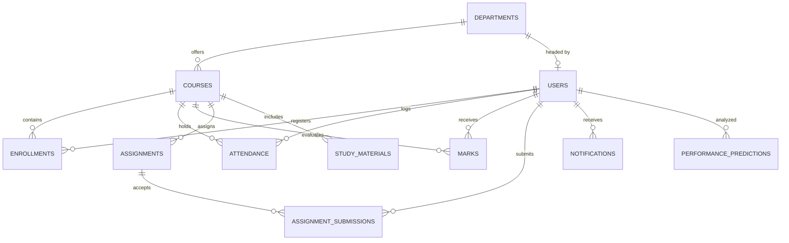

# CampusIQ Database Entity Relationship (ER) Documentation

This directory documents the relational architecture of the PostgreSQL database for the CampusIQ platform.

## Relational Model Overview

